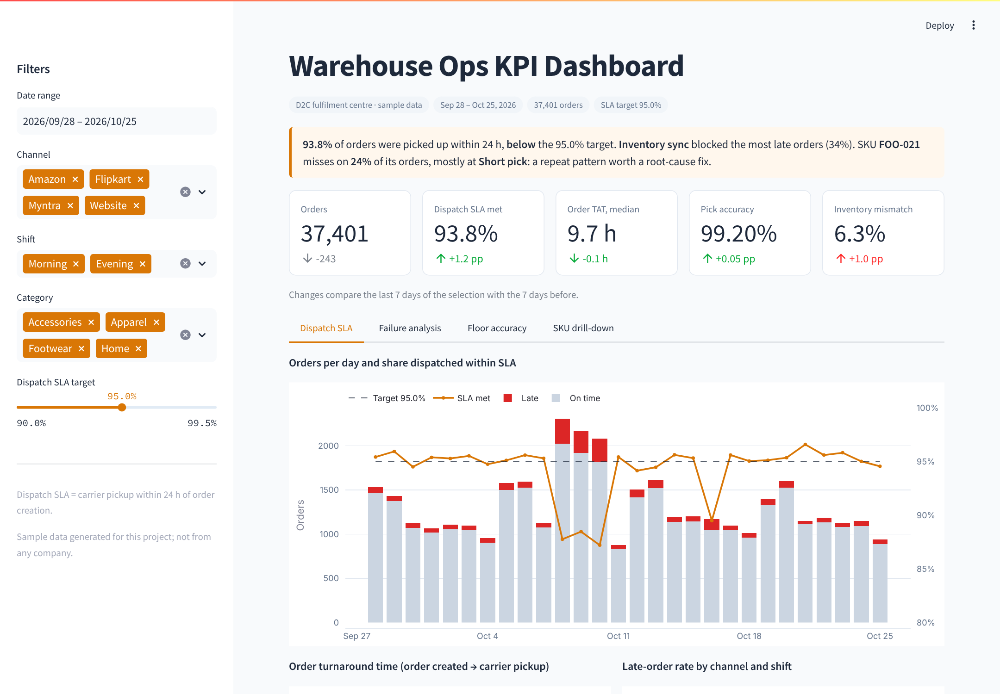
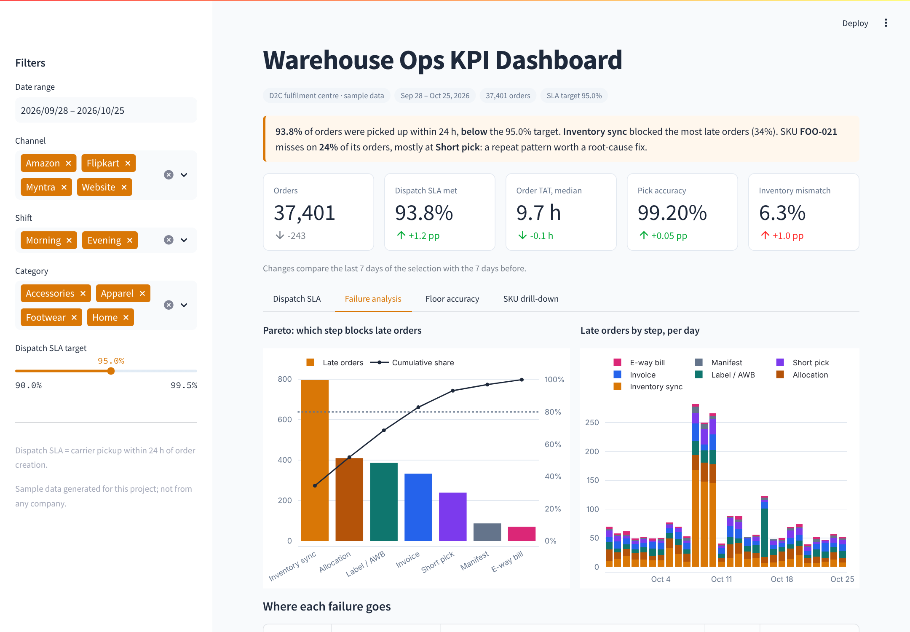
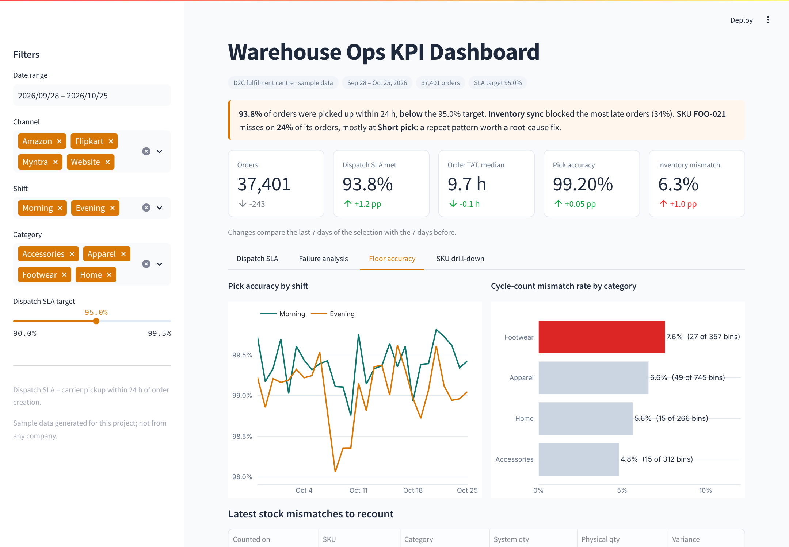
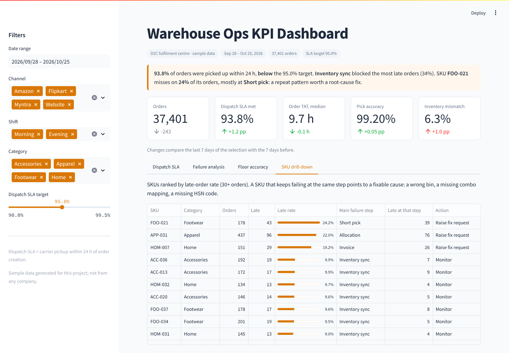

# Supply Chain Ops Portfolio · Charukant

Two projects on the operational tech layer of a D2C warehouse: how an order moves from inbound stock to carrier handover, where that flow breaks, and how a first-line team triages, routes and tracks each failure.

## 1. D2C Warehouse Pre-Dispatch Teardown & Issue-Triage Playbook

**[View the deck (PDF)](case-study/Warehouse_PreDispatch_Playbook.pdf)** · [Download PowerPoint](case-study/Warehouse_PreDispatch_Playbook.pptx)

13 slides covering:

- The 10-step pre-dispatch flow (GRN → putaway → inventory sync → allocation → picklist → pick & pack → invoice → label/AWB → manifest → e-way bill & handover), with the system of record and the "proof it is done" for each step
- Where each step breaks, what the floor sees, the likely root cause and who fixes it (ERP/SAP, OMS/Unicommerce, WMS, carrier, finance/tax)
- A triage flow, P1–P4 severity and SLA tiers, a seven-field escalation ticket, and an issue log with a weekly repeat-failure review
- GST e-invoice and e-way bill checks that can stop a load from leaving
- A 30-day plan for running this as the first-line owner

## 2. Warehouse Ops KPI Dashboard (Streamlit)

**[Open the app code](dashboard/app.py)** · screenshots below

An interactive Streamlit dashboard over a 37,401-order sample month for one fulfilment centre:

- **KPIs:** dispatch SLA met (carrier pickup within 24 h), order TAT, pick accuracy and cycle-count mismatch, each with its change over the prior 7 days
- **Dispatch SLA:** daily on-time vs late orders against the target, TAT distribution, late rate by channel and shift
- **Failure analysis:** Pareto of the step that blocked each late order, failures by day, and a routing table of who fixes what
- **Floor accuracy:** pick accuracy by shift, mismatch rate by category, latest bins to recount
- **SKU drill-down:** SKUs ranked by late rate, flagged for a fix request when they fail at the same step again and again
- Filters for date range, channel, shift, category and the SLA target; CSV export of the filtered orders






### Run it locally

```bash
cd dashboard
pip install -r requirements.txt
streamlit run app.py
```

### Deploy it free

On [share.streamlit.io](https://share.streamlit.io), sign in with GitHub, choose **Create app**, pick this repo, set the main file to `dashboard/app.py` and deploy.

### Data

The data is synthetic, generated by [`dashboard/generate_sample_data.py`](dashboard/generate_sample_data.py) for a fictional brand (Sep 28 – Oct 25, 2026). It does not come from any company. To regenerate it: `cd dashboard/data && python ../generate_sample_data.py`.
